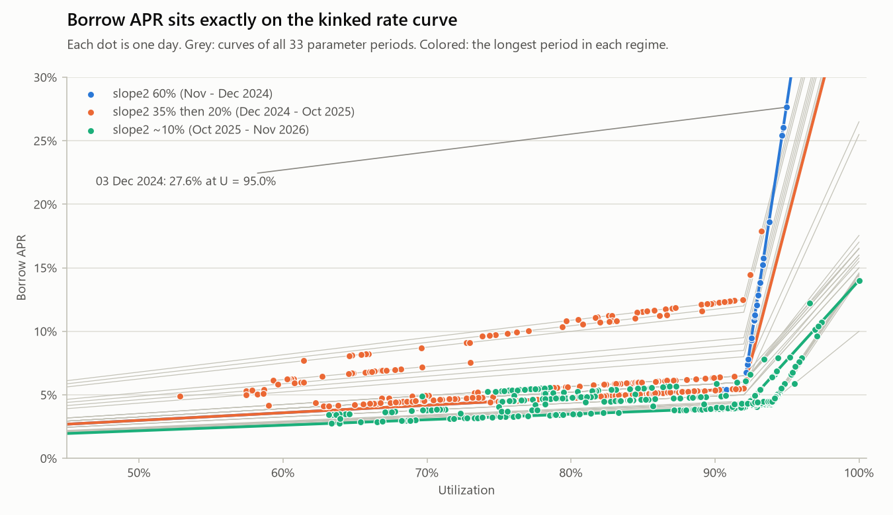
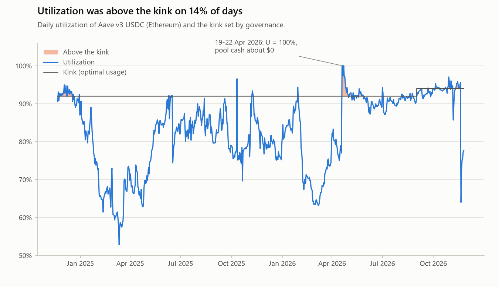
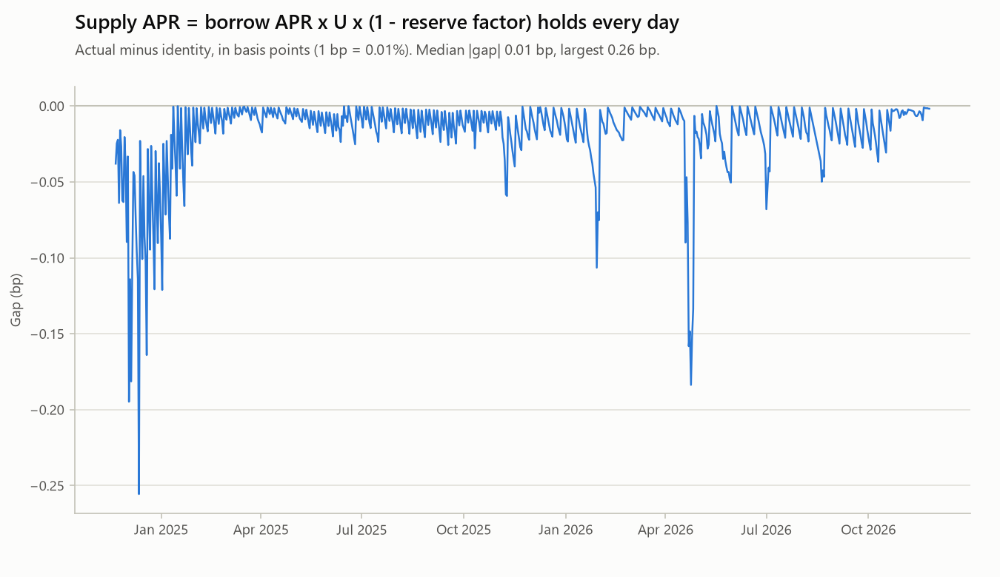
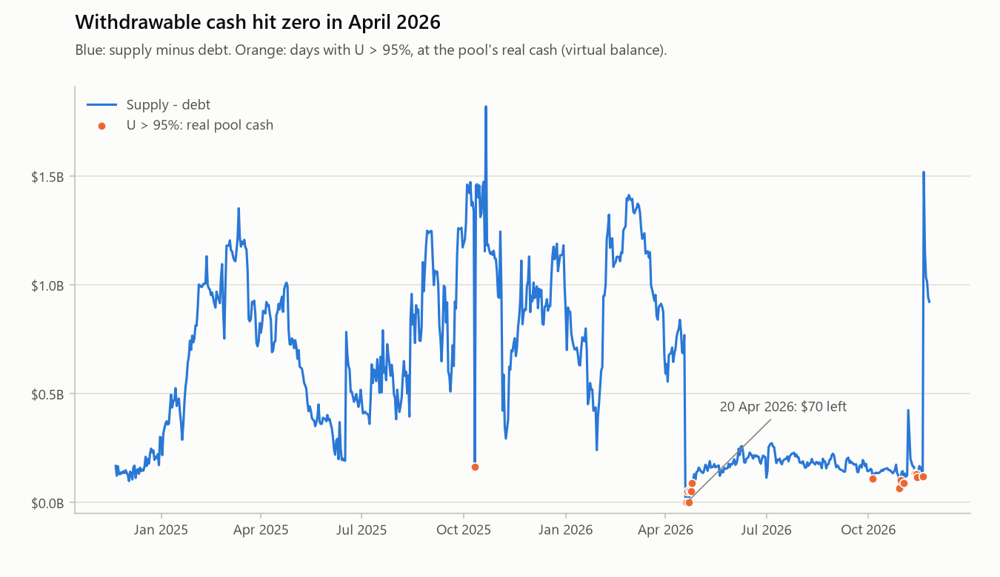

# Aave v3 USDC — Interest Rate Curve and Liquidity Risk

## How I built this

I did this project to get back into Python and to learn how DeFi lending works from the on-chain data itself
rather than from articles. I built it with [Claude Code](https://claude.com/claude-code) as a tutor and pair
programmer. Most of the code was not written by me from scratch: my work was to understand how it is written and
the market mechanics behind every number. For each step Claude first explained the concept (JSON-RPC and
`eth_call`, ABI encoding, ray units, configuration bitmaps, utilization, the kinked rate model), then I wrote the
most instructive pieces myself, with hints and code review:

- `encode_address`, `split_words`: ABI encoding and decoding
- `decode_reserve_factor`: reading a field out of the configuration bitmap
- `utilization`, `model_borrow_rate`: the rate model
- `sample_blocks`: the daily block grid
- `share_of_days_above_kink`, `predicted_supply_apr`: the analysis

Every step ended with interview-style questions on the code and the market mechanics, and the commit history
follows those steps. The goal was to be able to explain every line of code and every mechanism behind the
findings.

## Research question

How does the interest rate model of the Aave v3 (Ethereum) USDC pool behave in practice, and how often did
depositors face withdrawal-liquidity risk (utilization approaching 100%)?

## TL;DR

The rate model follows its formula almost exactly: with each day's parameters it reproduces the on-chain borrow
APR with a median error of 0.015 bp, but those parameters were changed 32 times in two years. What we have seen
from the project is that the utilization rate was above the kink on 14.2 percent of days over two years. Lenders
faced liquidity risk (utilization above 95%) on 2.2 percent of days (16 of 731), and the longest stretch lasted
7 days, from 19 to 25 April 2026. On the worst day, the pool's cash dropped to $70. This was a liquidity
problem, not a loss: lenders' balances kept earning interest (bad debt was not measured).

## Background: how Aave lending works (in my own words)

This is my own summary of the mechanism as I learned it while building the project.

Lenders deposit USDC in the pool to earn interest, while borrowers pay interest on what they borrow. The borrower
APR is always larger than the lender APR. A small portion of this difference goes to the Aave treasury (the
reserve factor, 10% of the interest), but most importantly it exists because borrowers pay interest only on the
lent tokens, while it is shared among all tokens in the pool, including the idle ones. The APR is set by a formula
of the utilization rate (and parameters decided by Aave governance and its risk stewards). The higher the
utilization, the higher the APR lenders receive and borrowers pay. This can be seen as a risk premium, or basic
supply-demand mechanics. This mechanism also protects lenders from liquidity risk, the risk that there is not
enough idle USDC in the pool to withdraw. To do this, Aave uses a rate curve of two linear segments that meet at
the kink (92–94% for USDC). The second segment is much steeper than the first. So, when the kink is exceeded,
the APR rises steeply, which attracts new lenders and pushes borrowers to repay.

Another feature of Aave is that every loan is over-collateralized. How much a borrower can borrow is set by the
LTV (loan-to-value) of their collateral, e.g. 81% for WETH. USDC and USDT have an LTV of 0% in this market, so
they cannot back new loans. The loan, then, should keep a health factor above 1, which is calculated as
(collateral value × liquidation threshold) / debt value. If the health factor falls below 1, the position is
liquidated by bots, which repay part of the debt and receive collateral worth that amount plus a bonus (5% for
WETH). However, if the collateral's value sinks too fast, the bots cannot liquidate in time and the collateral
can end up worth less than the debt. This uncovered part is called bad debt, and it is a solvency risk for
lenders: they could lose part of their money. Bad debt is out of scope of this project.

## Data and method

All data is read directly from the Aave v3 Pool on Ethereum mainnet with raw JSON-RPC `eth_call` requests at
historical blocks (no web3.py, no subgraph), so every byte of ABI encoding and decoding is visible in the code.

- **Sample:** one block per day (every block number that is a multiple of 7,200), 731 days from 2024-11-21 to
  2026-11-25.
- **Per day:**
  - `Pool.getReserveData(USDC)`: borrow APR, supply APR, reserve factor (bits 64–79 of the configuration
    bitmap) and the addresses of the aToken, the variable debt token and the rate strategy.
  - `totalSupply()` of the aToken (what depositors are owed) and of the variable debt token (what borrowers owe).
    **Utilization U = debt / supply.**
  - `getInterestRateDataBps(USDC)` on the rate strategy: optimal usage (the *kink*), base rate, slope1, slope2.
- **On stress days (U > 95%):** `Pool.getVirtualUnderlyingBalance(USDC)`, the USDC cash actually held by the
  pool, i.e. the most depositors could withdraw at that block.

The rate model being tested (all values annual, as fractions):

```
U <= kink:  borrow APR = base + slope1 × U / kink
U >  kink:  borrow APR = base + slope1 + slope2 × (U − kink) / (1 − kink)
supply APR = borrow APR × U × (1 − reserve factor)
```

## Findings

### 1. Borrow APR follows the two-slope model exactly, but the model itself was re-tuned 32 times



With each day's own parameters, the formula above reproduces the on-chain borrow APR with a median error of
**0.015 bp** (95% of days within 1.3 bp, largest 11.5 bp, during the steep slope2 = 60% period). So the
interesting part is not the formula but its parameters: between daily samples they changed **32 times in two
years** (33 periods in [`data/usdc_rate_param_periods.csv`](data/usdc_rate_param_periods.csv), some of them
only one or two days long):

| Parameter | Change over the window |
|---|---|
| slope2 | 60% → 35% (2024-12-16) → 20% (2025-08-03) → 10% (2025-10-03) |
| slope1 | 5.5% → 12.5% (2024-12-16), then down in steps to 4% (2026-03-08, with a rise to 6.5% in Aug 2025), now 4.6% |
| kink | 92% → 94% (2026-09-01) |
| base | 0% throughout |

The highest borrow APR in the sample was **27.6% on 2024-12-03 at U = 95.0%**, under slope2 = 60%.
A few one- or two-day slope2 values (e.g. 5.5% on 2026-10-30/31) were not checked against governance records
and are not interpreted here.

### 2. Utilization was above the kink on 14% of days, very unevenly across regimes



| Regime (split on slope2 cuts) | Days | Days above kink | Median U |
|---|---:|---:|---:|
| slope2 60% (Nov – Dec 2024) | 25 | 22 (88.0%) | 92.8% |
| slope2 35% then 20% (Dec 2024 – Oct 2025) | 289 | 7 (2.4%) | 82.2% |
| slope2 ~10% (Oct 2025 – Nov 2026) | 417 | 75 (18.0%) | 89.3% |

This is a correlation, not the effect of slope2. On 2024-12-16 slope1 was also raised from 5.5% to 12.5%,
which makes borrowing below the kink more expensive. A lower slope2 on its own makes borrowing above the kink
*cheaper*, so it would push utilization up, not down. Borrowing demand also changed with the market, the first
regime is only 25 days long, and risk managers change parameters in response to utilization.

### 3. The supply-rate identity holds to within 0.26 bp on every day



`supply APR = borrow APR × U × (1 − reserve factor)` matches the on-chain supply APR with a median gap of
**0.010 bp** and a largest gap of **0.26 bp**. The gap is never positive and has a sawtooth shape. A likely
explanation (not verified) is the treasury's accrued-but-not-yet-minted share: it is missing from the aToken
supply, grows between mints and resets when it is minted.

### 4. Withdrawable cash fell to $70 in April 2026



- **16 days with U > 95%** and **3 days with U > 98%**: 2026-04-19, 04-20 and 04-22.
- On those three days the pool held **$60k, $70 and $567** of USDC against $1.9–2.5B of deposits.
  Depositors could withdraw essentially nothing until borrowers repaid or new deposits arrived.
- **The trigger was a withdrawal, not a borrowing surge.** Between the 04-18 and 04-19 samples, supply fell by
  **$835M** while debt fell by $64M, taking U from 77.0% to 100%. Debt then fell every day, from $2.58B on 04-18
  to $1.75B on 04-26. Why depositors left is not visible in this data.
- Between 04-19 and 04-22 supply and debt both fell by about $0.6B: USDC that borrowers repaid was withdrawn
  by waiting depositors almost at once, so cash never built up.
- Borrow APR was at its ceiling of **14%** (base 0% + slope1 4% + slope2 10%), giving depositors ~12.6%.
  In December 2024, 95% utilization had already cost borrowers 27.6%.
- The squeeze was short at daily resolution: on 2026-04-21 the pool held $53M again. But the cash buffer did
  not return to its earlier level: supply − debt had a median of **$0.78B** before 2026-04-19 and **$0.18B**
  between late April and 2026-11-19.
- On 2026-11-20 a **+$1.52B** deposit dropped U from 95.6% to 64.0%. Debt then grew by $0.5B within five
  days (U back to 77.6% on 2026-11-25).

Nothing in this data shows depositors losing money in these episodes: their aToken balances kept accruing
interest. What they faced was **liquidity** risk (not being able to exit on demand). **Solvency** risk (bad
debt, when a borrower's collateral is worth less than the debt) was not measured here.

## Limitations

- **Daily sampling** misses intraday moves. The stress-day counts are a lower bound: utilization may have hit
  100% within days whose sampled block looked fine.
- **APR, not APY.** All rates are annual rates as stored on-chain. With per-second compounding, APY ≈ e^APR − 1
  (14% APR ≈ 15.0% APY).
- **Utilization definition.** U = variable debt / aToken supply. The aToken supply excludes the treasury's
  unminted share, so U reads slightly above 100% when the pool is drained (max 100.013%). Aave's internal
  utilization uses the pool's virtual balance instead. The small difference matters most where the curve is
  steep, which is likely why the model's largest errors fall in the slope2 = 60% period.
- **USDC is treated as $1.**
- **One pool on one chain.** Depositors and borrowers can move between Aave markets and other lending
  protocols. None of that is observed here.
- **No causal claims.** The regimes differ in length and in market conditions. The reasons behind parameter
  changes were not checked against governance discussions.
- **Single data source.** Values come from one public RPC node and were cross-checked only at one reference
  block (2026-11-23).
- The sample time drifts a few minutes per day (a real day has ~7,167 blocks, not 7,200), and 4 calendar days
  are missing.

## What I learned

- **Reading the chain without a library.** Working with raw hex data and ABI decoding was the most valuable part
  of this project, because it was completely new to me. Building each call by hand (a 4-byte keccak selector plus
  a padded 32-byte argument), splitting the answer into 32-byte words and pulling the reserve factor out of a
  bitmap with a shift and a mask showed me how a contract's state is actually stored and returned, which a
  library like web3.py would normally hide.
- **The same outcome can have several causes.** After slope2 was cut in December 2024, utilization fell, although
  in theory a cheaper rate above the kink should push it up. slope1 was raised on the same day and demand changed
  too, so the data cannot say which one did it. I first thought the April 2026 squeeze came from a crypto rally
  that made people borrow more. The data showed the opposite: $835M was withdrawn within a day while debt fell.
  I now check a story against the data before I tell it.
- **Liquidity is not solvency.** The pool held $70 of cash and still owed every depositor their full balance,
  with interest. The risk was timing (not being able to exit), not loss. The words matter too: depositors
  *withdraw*, while *liquidation* is what happens to an under-collateralized borrower.
- **The formula is fixed, the parameters are the policy.** The rate model reproduced the on-chain borrow APR
  almost exactly, so the formula itself holds no surprises. What changed the market was its parameters: they were
  changed 32 times in two years, and a borrower paid 27.6% at 95% utilization in December 2024 but at most 14% at
  100% utilization in April 2026. To understand a lending market's risk, I would watch who changes these
  parameters and why.

## Reproduce

```powershell
python -m venv .venv
.\.venv\Scripts\Activate.ps1
pip install -r requirements.txt

python src/m1_snapshot.py        # USDC reserve snapshot: reference block vs. latest block
python src/m2_fetch_history.py   # daily snapshots -> data/usdc_daily.csv (safe to re-run)
python src/m3_rate_params.py     # rate model parameters per day + periods + model check
python src/m4_analysis.py        # summary numbers + charts/*.png (fetches pool cash on stress days once)
```

The RPC endpoint is read from the `RPC_URL` environment variable and defaults to `https://eth.drpc.org`
(a free public node that serves historical `eth_call`). To use another node:

```powershell
$env:RPC_URL = "https://your-node.example"
```

The fetch scripts sample a fixed grid of blocks, so re-runs skip blocks that are already saved.

## Project layout

```
src/      Python code (rpc.py: JSON-RPC, abi.py: encoding/decoding, aave.py: Aave reads, m1–m4: steps)
data/     fetched on-chain data (CSV)
charts/   generated figures (PNG)
```

The commit history follows the build steps: setup → first `eth_call` → daily history → rate parameters →
analysis → write-up.
